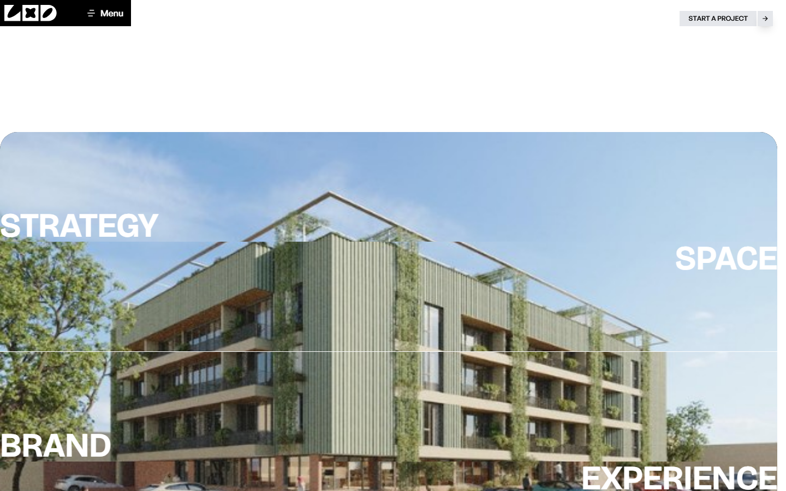
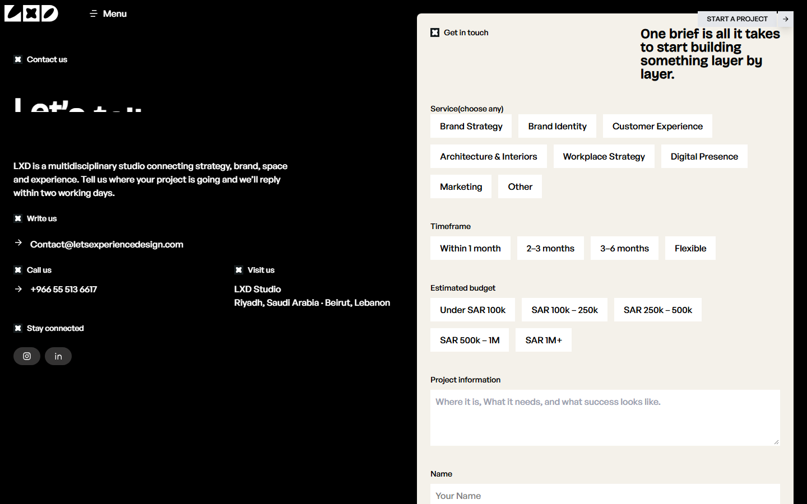

# LXD

LXD is a portfolio site for a multidisciplinary studio working across strategy, brand, architecture, space, and experience. It features project and service pages, animated visual sections, and a client-side contact enquiry form.

## Screenshots

| Building showcase | Contact page |
| --- | --- |
|  |  |

## Stack

- React 19 and Vite
- React Router for page navigation
- Tailwind CSS 4 for styling
- GSAP and `@gsap/react` for animation
- Three.js with React Three Fiber and Drei for 3D
- Remixicon for interface icons
- Oxlint for linting

## Run locally

Use Node.js 20.19+ or 22.12+, then install dependencies and start the development server:

```bash
npm install
npm run dev
```

Vite prints the local URL when the server is ready.

## Pages

- `/` — Building showcase
- `/hero` — Studio landing page
- `/about` — About the studio
- `/services` — Services
- `/projects` — Selected projects
- `/contact` — Contact details and enquiry form

The contact form validates entries in the browser and logs a successful enquiry to the console; it is not connected to a backend.

## Other commands

```bash
npm run lint    # Check the code
npm run build   # Create a production build in dist/
npm run preview # Serve the production build locally
```
